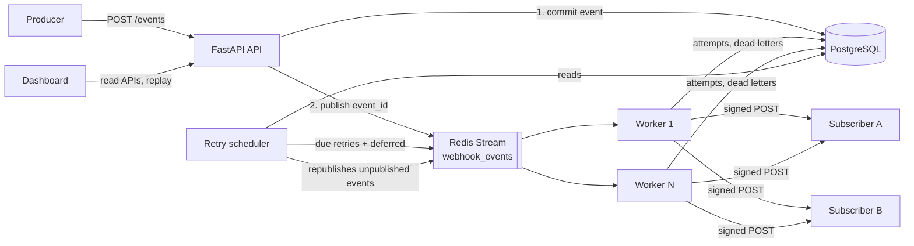

# Webhook Reliability Gateway

A self-hostable, at-least-once webhook delivery system. Producers send events once; the gateway stores them durably, deduplicates them, signs them, delivers them to every subscribed endpoint, retries failures with backoff, stops hammering broken endpoints with a circuit breaker, and parks permanent failures in a dead-letter queue you can replay.

[Kill and recover demo](docs/demo.mp4)

*The "kill and recover" demo, run entirely from the dashboard: kill a subscriber, send events, watch retries and the circuit breaker, restore it, watch the backlog drain.*

## Features

- **Idempotent ingest.** `POST /events` with an `idempotency_key`; duplicates (including concurrent ones) return the original event.
- **Signed deliveries.** HMAC-SHA256 over `timestamp.payload`, sent as `X-Webhook-Signature` and `X-Webhook-Timestamp`.
- **At-least-once delivery** through Redis Streams consumer groups, with crash recovery (`XAUTOCLAIM`).
- **Retries** with exponential backoff and jitter, scheduled outside the worker so nothing blocks.
- **Per-subscriber circuit breaker.** Five consecutive failures mark a subscriber `degraded`; new events are deferred (not lost) and a health check closes the circuit on recovery.
- **Dead-letter queue and replay** targeted at one subscriber.
- **Horizontal scaling.** Run N workers on one consumer group with no code change.
- **Live dashboard** (Next.js): subscriber health, delivery feed, stats, dead letters, event form, and a kill/restore switch for the demo subscriber.

## Architecture



PostgreSQL is the source of truth; Redis only carries work (an event id, plus a subscriber id for retries and replays). See [`docs/schema.md`](docs/schema.md) and [`docs/delivery-states.md`](docs/delivery-states.md).

## Quickstart

Prerequisites: Docker with Compose.

```bash
# 1. configure (see .env contents below)
docker compose up --build -d

# 2. create the tables
docker compose exec api alembic upgrade head

# 3. register the two demo subscribers (one flaky, one healthy)
docker compose exec -e WEBHOOK_SECRET=<your WEBHOOK_SECRET> \
    -e WEBHOOK_SECRET_2=day5-healthy-secret \
    api python scripts/seed_demo.py
```

| Service | URL |
|---|---|
| Dashboard | http://localhost:3000 |
| API + docs | http://localhost:8000 / http://localhost:8000/docs |

The `.env` file needs `POSTGRES_USER`, `POSTGRES_PASSWORD`, `POSTGRES_DB`, `DATABASE_URL`, `REDIS_URL` and `WEBHOOK_SECRET` (the secret the demo subscriber verifies signatures with).

### Run the kill-and-recover demo

For a watchable demo, shorten the backoff and health-check interval, then recreate the worker:

```bat
set RETRY_DELAYS=1,2,3,4,5
set CIRCUIT_HEALTH_CHECK_INTERVAL=10
docker compose up -d worker
```

Then in the dashboard:

1. Click **Kill** on the demo subscriber.
2. Send **5 events** (event type `order.created`). Retries appear in the live feed and the Flaky subscriber turns 🟡 degraded; later events show as `deferred`.
3. Click **Restore**. The health check closes the circuit, the backlog drains, the badge returns to 🟢.
4. To see a dead letter, kill the subscriber and send exactly **one** event; after five failed attempts it lands in *Dead letters*. Restore, then click **Replay**.

Or run the scripted version (100 events, verifies zero loss and zero duplicates):

```bash
docker compose exec -e WEBHOOK_SECRET=<your WEBHOOK_SECRET> worker \
    python /app/scripts/kill_and_recover_demo.py
```

### Scale workers

```bash
docker compose up -d --scale worker=3 worker
```

### Tests

```bash
docker compose exec api pytest -v --ignore=tests/test_circuit_breaker.py --ignore=tests/test_worker_reliability.py
docker compose exec worker pytest /app/tests/test_circuit_breaker.py /app/tests/test_worker_reliability.py -v
```

Tests that import the worker only run in the worker container.

## Load test results

Measured with Locust on a single Windows laptop (API, Postgres, Redis, workers and the load generator all on one machine). About 125,000 events across 7 runs: **zero lost, zero duplicate deliveries**, checked in the database and at the receiver.

| Workers | Target rps | Ingest rps | Ingest p99 | Delivery /s | Backlog drain |
|---|---|---|---|---|---|
| 3 | 50 | 49.8 | 260 ms | n/a | 23 s |
| 3 | 100 | 100.3 | 700 ms | n/a | 78 s |
| 1 | 400 | 137.3 | 3.3 s | 31.6 | 474 s |
| 3 | 400 | 117.8 | 4.8 s | 68.9 | 103 s |

Highlights: ingest saturates around 150 events/s on this machine; one worker delivers about 32 events/s and three deliver about 69/s (2.2x). Unloaded end-to-end latency (20 rps): p50 168 ms, p99 628 ms. Full table and caveats in [`docs/load-test-results.md`](docs/load-test-results.md).

## Design decisions

Why commit-then-publish with a reconciler, why Redis Streams, why HMAC, and what would change at 10x: [`docs/design-decisions.md`](docs/design-decisions.md).

## Project layout

```text
api/            FastAPI app, models, Alembic migrations, tests, scripts
workers/        delivery worker and retry scheduler
dashboard/      Next.js dashboard
demo-subscriber/ signature-verifying receiver with an outage switch
loadtest/       Locust files
docs/           schema, delivery states, load test results, design decisions
```

## Status and limits

- Runs locally with Docker Compose. It has not been deployed publicly.
- Delivery is at-least-once. A crash between the HTTP call and the database commit can redeliver, so receivers should deduplicate.
- The retry scheduler is a single instance by design (see design decisions).
- No authentication on the management API; this is a demo system.